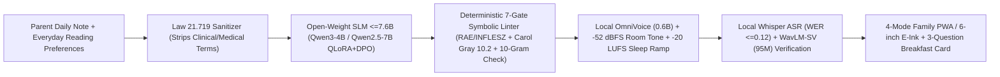

# Un Cuento, Un Abrazo — Open Human-Scale Universal-Design Storytelling Engine

[](./LICENSE)
[](./docs/OPEN_SPANISH_CORPUS_LEDGER_SPEC.md)
[](./docs/EINK_OPEN_HARDWARE_SPEC.md)
[](./motor/motor_local_human_scale.py)
[](https://un-cuento-un-abrazo.netlify.app)

**Un Cuento, Un Abrazo** (*"One Story, One Hug"*, developed in Rancagua, Chile by **ROANSO SpA**) is an open-source, screen-safe Spanish storytelling and nocturnal audio engine built around **Human-Scale AI** principles: **Small open-weight models (`4.0B` & `7.6B`), Intentional child-privacy guardrails, and Tailored Invisible Universal Design mechanics**—with **zero AI chatbots talking to children**, **zero clinical profiling**, and **zero runtime dependency on frontier cloud APIs**.

> **Live Auditable Family PWA & Real Audio Showcase:** https://un-cuento-un-abrazo.netlify.app
> Test our **Invisible Universal Design** family app (4 reading/listening modes: *Audio-Only Sleep Mode*, *Read & Imagine*, *Parent Reads*, and *Calm Illustrations + Audio*), 3-question morning breakfast cards, Whisper-verified Chilean Spanish `.mp3` bedtime chapters, Airplane-Mode Offline `206 Range` caching, Child Amber Bedside Lock (demo PIN `0000`), and the live **Law 21.719 Child Privacy & Safety Portal** (`AES-256-GCM` + `HKDF` 1-click adult voice shred & ARCO portability).

---

## Why Human-Scale AI for Bedtime Storytelling?

Mainstream AI story apps rely on massive cloud frontier models that generate translated English clichés (*"AI slop"*) and moralizing sermons, expose minors to interactive screens/chatbots, ask parents to disclose sensitive clinical diagnoses, and charge cloud TTS rates (\$0.40–\$0.60 USD per chapter) that price out Latin American families and public schools.

Bedtime storytelling is **asynchronous and domain-bounded**. That lets us replace extractive cloud stacks with a compact, auditable open-weight pipeline running sequentially on a single consumer GPU (`8–16 GB VRAM`):



### Core Model Stack & Parameter Footprint (`--auditoria-mozilla`)

| Layer | Open Model / Engine | Parameters | License | Runtime Footprint | Frontier API? |
|---|---|---:|---|---|---|
| Edge Narrative SLM + Chilean `QLoRA+DPO` | `Qwen/Qwen3-4B` + `roanso-chileno-lora-v1` | **4.0 B** | Apache-2.0 | Consumer GPU 4-bit NF4 (**2.87 GB VRAM**) | **No** |
| Batch Narrative SLM + Chilean `QLoRA+DPO` | `Qwen/Qwen2.5-7B-Instruct` + `roanso-chileno-lora-v1` | **7.6 B** | Apache-2.0 | Consumer GPU 4-bit NF4 / Q4_K_M (~5.2 GB VRAM) | **No** |
| Deterministic Safety & Readability | `motor/pipeline_multinino.py` (symbolic RAE syllabifier, INFLESZ, Carol Gray 10.2) | **0 B** | Apache-2.0 | Pure Python CPU / Offline | **No** |
| Nocturnal Speech + Sleep Ramp | `OmniVoice` / `F5-TTS` Spanish + `-52 dBFS` warm room tone | **0.6 B** | Apache-2.0 / MIT | Consumer GPU (~2.4 GB VRAM FP16) | **No** |
| Audio-to-Script Intelligibility QA | `faster-whisper` (`small` open weights) | **0.81 B** | MIT | Local CPU / GPU | **No** |
| Timbre & Adult Consent Verification | `WavLM-Base-Plus-SV` | **0.095 B** | MIT | Local CPU / GPU | **No** |

---

## Cryptographically Proven Open-Weight QLoRA + DPO Runs (`<= 7.6B`)

Both open-weight adapters were trained **100% air-gapped (`HF_HUB_OFFLINE=1`)** on `Tesla T4 x2` GPUs using native PyTorch + `PEFT` (`4-bit NF4` + exact `disable_adapter()` reference `DPO`) exclusively over our `SHA-256`-verified ledger of `101,968` Public Domain and `CC-BY-4.0` Spanish/Chilean words (`corpus/licencias_corpus.csv`). Full provenance is tracked in [`platform/training/kaggle_gpu_runs_provenance.json`](./platform/training/kaggle_gpu_runs_provenance.json):

| Base Model (`Apache-2.0`) | Params | Quantization | Held-Out Base -> LoRA PPL | PPL Reduction | 5-Scenario Gate Pass Rate | Adapter `SHA-256` Prefix |
|---|---:|---|---|---|---|---|
| `Qwen/Qwen3-4B` | `4.0B` | `qlora_nf4_4bit` (`3.7 GB` peak VRAM) | `32.76` -> **`12.62`** | **`-61.48%`** | **`5/5` (`100%`, Turn 1, `INFLESZ 70.4`)** vs `0/5` Base | `cc8eb21f28cb2a74...` |
| `Qwen/Qwen2.5-7B-Instruct` | `7.6B` | `qlora_nf4_4bit` (`6.6 GB` peak VRAM) | `13.27` -> **`10.63`** | **`-19.89%`** | **`3/5` (`60%`, `INFLESZ 68.0`)** vs `0/5` Base | `6cd46fd04282218e...` |

*(Full Dual-T4 benchmark report and 10-gram anti-regurgitation verification across `69,533` corpus n-grams: [`platform/training_data/BENCHMARK_KAGGLE_DUAL_T4.md`](./platform/training_data/BENCHMARK_KAGGLE_DUAL_T4.md) and [`kaggle_dual_t4_benchmark_report.json`](./platform/training_data/kaggle_dual_t4_benchmark_report.json).)*

---

## Key Invisible Universal Design & Child-Privacy Innovations

1. **Invisible Universal Design Without Clinical Profiling (Chilean Law 21.719):**
   Instead of medical tags or clinical labels, parents choose natural everyday preferences (*Clear, step-by-step stories*, *Calm nightly routine*, *Gentle slow narration*, local voice accent, and 4 delivery modes). Meanwhile, `sanitizar_onboarding_ley21719` deterministically strips clinical, diagnostic, and pharmacological terms before any record touches storage.
2. **22 Evidence-Backed Narrative Rules (`docs/NEURODIVERSITY_EVIDENCE_22_RULES.md`):**
   - **Clear & Step-by-Step (`demo_lucas`):** Short active sentences (`~12.6 words/sentence`, `Szigriszt-Pazos 74.8`), physical-to-emotional cause-and-effect, inline explanation of idioms, zero anxious cliffhangers, and steady `0.90x` mono-voice pacing.
   - **15-Second Hook + Physiological Sleep Ramp (`demo_mateo`):** Immediate action anchored in the child's interest in sentence 1, followed by gradual lexical and acoustic deceleration (`0.96x -> 0.92x -> 0.86x`).
   - **Carol Gray 10.2 & Practical Social Comprehension:** Blocks 2nd-person behavioral directives (*"you must behave"*) and AI sermons, pairing every story with a 3-question non-moralizing **Morning Breakfast Card** (*1. What did the character feel? 2. How did we notice their friend's true intentions? 3. What would you do at school?*).
3. **Cryptographic Adult Voice Vault (`AES-256-GCM` + `HKDF-SHA256`):**
   Strict child-voice prohibition; optional adult family voices require spoken consent verified via ASR, per-family `HKDF` key derivation, and 1-click cryptographic shredding.

---

## 30-Second Quickstart (`38/38` Automated Tests — Python 3.10+)

```bash
# 1. Print the verifiable Human-Scale AI model & parameter manifest
python motor/motor_local_human_scale.py --auditoria-mozilla

# 2. Run the 10-test deterministic core privacy, Carol Gray & INFLESZ suite
python -m unittest discover -s tests -v

# 3. Run the 28-test Cloud Control Plane, AES-256-GCM Voice Vault, QLoRA & PWA suite
python -m pip install -e "./platform[dev]"
python -m pytest platform/tests -v

# 4. Run the Zero-PII & Zero-Secrets repository security gate
python scripts/audit_public_repo.py

# 5. Launch the Multi-Tenant Control Plane + Invisible Universal Design Family PWA (http://127.0.0.1:8080)
uvicorn roanso_platform.api:create_app --factory --app-dir platform --port 8080
```

---

## Whisper-Verified Nocturnal Showcase Audio (`-20 LUFS` · `-52 dBFS` Room Tone)

All public `.mp3` showcase chapters in `platform/showcase_assets/` are synthesized with ethical *Voice Design* catalog voices (`Apache-2.0`, zero minor cloning, zero scraped actor audio) and verified end-to-end with `faster-whisper`:
- `demo_lucas_cap1.mp3` (`monovoz_estable`, `272.6 s`): **`Whisper WER = 0.0152` (`98.48%` accuracy)**, `-0.24 dB` steady dynamics.
- `demo_mateo_cap1.mp3` (*Sleep Ramp*, `116.3 s`): **`Whisper WER = 0.0035` (`99.65%` accuracy)**, `+1.48 dB` gentle attenuation.
- `demo_fresia_cap1.mp3` (*Sleep Ramp*, `230.3 s`): **`Whisper WER = 0.0179` (`98.21%` accuracy)**, `+1.01 dB` gentle attenuation.
- `demo_qwen3_4b_lora_chileno.mp3` (`Qwen3-4B + roanso-chileno-lora-v1` E2E, `83.6 s`): **`Whisper WER = 0.0201` (`98.49%` similarity)**, `2,868 MiB` SLM VRAM footprint, `Fernández-Huerta = 82.1`, Turn `1/1` pass (`demo_qwen3_4b_lora_chileno_report.json`).

---

## Repository Structure

- `platform/` — Multi-Tenant Cloud Control Plane (`FastAPI` + `SQLAlchemy 2.0` PostgreSQL/SQLite + Netlify Serverless Functions), `AES-256-GCM` + `HKDF` adult voice vault, `SKIP LOCKED` elastic GPU lease queue, air-gapped `Tesla T4 x2` `QLoRA+DPO` trainer & Dual-GPU benchmark (`platform/training/`), verified `.mp3` showcase assets, and 4-Mode Offline Family PWA.
- `motor/pipeline_multinino.py` — Universal Design engine, Law 21.719 clinical sanitizer, RAE phonological syllabifier, INFLESZ readability indices, Carol Gray 10.2 & anti-sermon linter, and 3-question breakfast card generator.
- `motor/motor_local_human_scale.py` — Local `<=10B` open-weights SLM orchestrator, frontier API domain blocker, and 10-gram corpus anti-regurgitation verifier.
- `corpus/` — `SHA-256` audited ledger (`licencias_corpus.csv`, `101,968` words) and license attributions.
- `voces/` — Nocturnal 3-register voice trainer (`WavLM-SV` + `Whisper` + spoken adult consent) and `-52 dBFS` *Sleep Ramp* synthesizer.
- `docs/` — Peer-reviewed 22-rule neurodiversity study, Spanish Public Domain / `CC-BY-4.0` corpus governance specification, and `CERN-OHL-P-2.0` 6" E-Ink bedside reader specification.
- `tests/` & `scripts/audit_public_repo.py` — Automated test suites (`38/38` tests) and pre-publish zero-PII security gate.

---

## Resumen en Español (Chile y Latinoamérica)

**Un Cuento, Un Abrazo** (desarrollado en Rancagua, Región de O'Higgins, por **ROANSO SpA**) es una plataforma abierta de cuentos nocturnos personalizados con **Diseño Universal Invisible**: sin etiquetas clínicas ni chatbots frente a niños, impulsada por modelos abiertos pequeños (`4.0B` y `7.6B` entrenados con `QLoRA+DPO` sobre literatura en dominio público y `CC-BY-4.0`), audio nocturno cálido (`-20 LUFS`, *room tone* continuo a `-52 dBFS`) y cumplimiento estricto de privacidad infantil (**Ley 21.719**).
