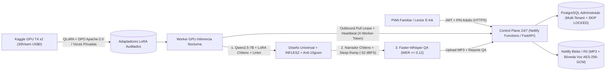

# Arquitectura Productiva a Escala — ROANSO SpA (*"Un Cuento, Un Abrazo"*)

Este módulo implementa la arquitectura profesional desacoplada lista para operar comercialmente combinando **Netlify (Control Plane 24/7 + PostgreSQL + Blobs)**, **Kaggle Notebooks GPU (`2x NVIDIA T4 16 GB = 32 GB VRAM`, costo US\$0 en entrenamiento)** y **nodos GPU elásticos por minuto** para inferencia nocturna, cumpliendo **Ley 21.719 (Chile)** y **Mozilla Human-Scale AI (`<= 10B` parámetros, cero APIs *frontier*)**.

---

## 1. Topología Desacoplada: Netlify Control Plane + Kaggle GPU Training + Inferencia *Scale-to-Zero*

### ¿Por qué usar Kaggle para entrenamiento en etapa semilla y expansión?
1. **Costo US\$0 en Fine-Tuning (`2x Tesla T4 16 GB`, 30 h/semana gratis):** Tanto el ajuste literario `QLoRA + DPO` sobre `Qwen/Qwen2.5-7B-Instruct` (~15–20 min por corrida completa de 497 pasajes humanos) como el entrenamiento acústico privado de los **2 actores de voz chilenos** corren íntegros en Kaggle sin quemar capital de Corfo Semilla Inicia en clusters GPU dedicados.
2. **Privacidad Contractual de Actores (`isPrivate: true` + `actor_voice_license.json`):** `training/kaggle_orchestrator.py` y `training/kaggle_tts_voice_kernel.py` empaquetan los datasets y kernels como **100% privados**, bloquean cualquier audio sin contrato comercial infantil firmado (`SHA-256`) y protegen con cerca estricta (`roanso-*`) cualquier otro proyecto preexistente en la cuenta Kaggle.
3. **Control Plane siempre disponible en Netlify + Inferencia *Scale-to-Zero*:** Netlify sirve instantáneamente la PWA, base PostgreSQL y catálogo de audios; los workers GPU solo se encienden cuando existen cuentos personalizados en cola (`204 No Content` = **US\$0,00/hora**).
4. **Tolerancia a fallos de GPUs *Spot* (60% más baratas):** Cada trabajo tiene un `lease_expires_at` renovado por *heartbeat*. Si un proveedor corta una instancia *spot*, `requeue_expired_leases()` devuelve automáticamente el trabajo a `QUEUED`.

---

## 2. Unit Economics Reales en GPU Arrendada (24 GB VRAM)

| Etapa en Nodo GPU (`NVIDIA L4` / `RTX 4090`) | Tiempo Promedio | Consumo |
|---|---|---|
| Escritura `Qwen2.5-7B-Instruct` + LoRA (`vLLM`) + Linter | ~4,5 s | Abierto (`Apache-2.0`) |
| Síntesis Nocturna `OmniVoice` + *Sleep Ramp* + *Room Tone* | ~17,5 s | Abierto (`Apache-2.0`) |
| Verificación Acústica `faster-whisper` (`WER <= 0.12`) | ~3,0 s | Abierto (`MIT`) |
| **Total por capítulo verificado (~750 palabras / ~6 min audio)** | **~25,0 s GPU** | **~US\$0,0038 (~CLP \$3,7 / cuento)** |

- **Capacidad de 1 nodo GPU arrendado:** ~140 capítulos/hora.
- **1.000 familias activas diarias:** se procesan en ~7 horas-GPU totales (~US\$3,80/noche o ~10 minutos corriendo 40 workers en paralelo).

---

## 3. Fronteras de Seguridad y Privacidad (Ley 21.719)

1. **Cero Diagnósticos Clínicos en Base de Datos:** `ChildProfileCreate` ejecuta `sanitizar_onboarding_ley21719` antes de crear la entidad ORM. Términos médicos (`TEA`, `TDAH`, fármacos) son purgados en memoria; solo se registra el contador anónimo `sanitized_terms_blocked_count`.
2. **Bóveda Biométrica `AES-256-GCM` + Borrado Criptográfico (`HKDF`):**
   - Prohibición estricta de voces de menores.
   - Cada embedding adulto se cifra con `AES-256-GCM` derivando una clave única mediante `HKDF-SHA256(master_key, key_salt, family_id)`.
   - `DELETE /v1/voices/{id}` elimina el objeto en `S3/R2` **y destruye `key_salt_hex`**, haciendo matemáticamente irrecuperable cualquier respaldo frío.
3. **Doble Compuerta Neuro-Inclusiva:** Aunque el nodo GPU ejecuta `SelfHealingStoryEngine`, el Control Plane vuelve a correr `analizar_cuento_multinino` + `verificar_anti_regurgitacion_ngramas` en `/complete` antes de aceptar un capítulo como `READY`.
